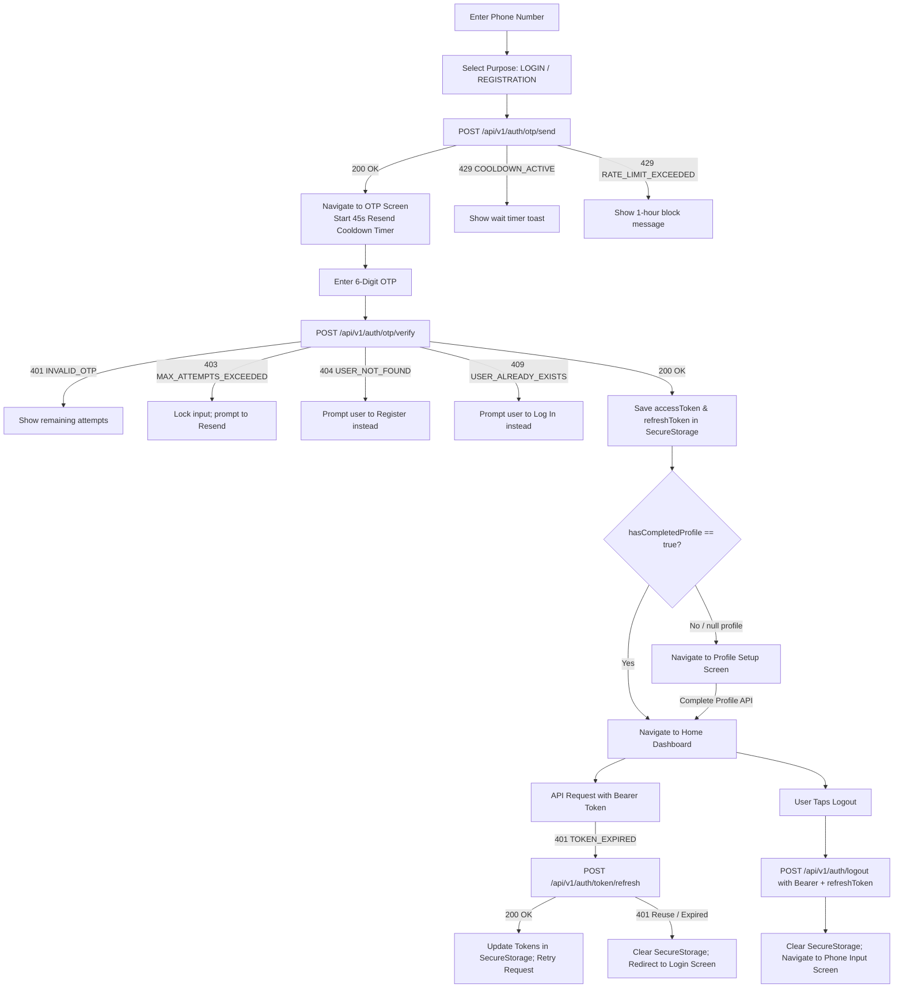

# ASCAS Backend — Flutter Authentication Integration Contract

> **Target Audience:** Flutter Frontend Engineers, Mobile Architecture Team<br/>
> **Backend Architecture:** Express 5, TypeScript, Node.js (Offline-First Mock Repository Architecture)<br/>
> **API Version:** `v1`<br/>
> **Document Status:** Verified against Backend Implementation (`backend` branch)

---

## Table of Contents

1. [API Base URL & Network Configuration](#1-api-base-url--network-configuration)
2. [Standard Response Envelope Format](#2-standard-response-envelope-format)
3. [Authentication Endpoints Specification](#3-authentication-endpoints-specification)
   - [3.1 POST /api/v1/auth/otp/send](#31-post-apiv1authotpsend)
   - [3.2 POST /api/v1/auth/otp/verify](#32-post-apiv1authotpverify)
   - [3.3 POST /api/v1/auth/token/refresh](#33-post-apiv1authtokenrefresh)
   - [3.4 POST /api/v1/auth/logout](#34-post-apiv1authlogout)
   - [3.5 GET /api/v1/auth/me](#35-get-apiv1authme)
4. [Request Validation Rules (Zod Schemas)](#4-request-validation-rules-zod-schemas)
5. [Complete Error Codes & HTTP Status Matrix](#5-complete-error-codes--http-status-matrix)
6. [OTP Lifecycle, Rate Limits & Lockout Rules](#6-otp-lifecycle-rate-limits--lockout-rules)
7. [JWT & Refresh Token Architecture](#7-jwt--refresh-token-architecture)
8. [Logout Security & Multi-Device Session Handling](#8-logout-security--multi-device-session-handling)
9. [Flutter Token Storage Recommendations](#9-flutter-token-storage-recommendations)
10. [Handling 401, 403, and Token Refresh in Flutter (Dio)](#10-handling-401-403-and-token-refresh-in-flutter-dio)
11. [Registration vs. Login: Profile Completion Flow](#11-registration-vs-login-profile-completion-flow)
12. [Offline-First / Mock Repository Limitations](#12-offline-first--mock-repository-limitations)
13. [End-to-End Flutter Authentication Flow](#13-end-to-end-flutter-authentication-flow)

---

## 1. API Base URL & Network Configuration

The backend exposes all authentication endpoints under the `/api/v1/auth` sub-path.

### Base URLs by Target Environment

| Environment | Platform / Device | Base URL |
| :--- | :--- | :--- |
| **Development** | Android Emulator | `http://10.0.2.2:5000/api/v1` |
| **Development** | iOS Simulator | `http://localhost:5000/api/v1` |
| **Development** | Physical Device (LAN) | `http://<DEVELOPER_MACHINE_LAN_IP>:5000/api/v1` |
| **Production** | Production Domain | *To be configured upon cloud deployment* |

### Cross-Origin & Network Policy
- **CORS:** The backend uses `cors()` configured to accept requests with no `origin` header, permitting native Flutter mobile clients (Dio / HttpClient on Android and iOS).
- **Security Headers:** The backend enforces standard HTTP security headers via `helmet()`.
- **Payload Limits:** JSON body parser accepts up to `10mb`.

---

## 2. Standard Response Envelope Format

All responses from the backend adhere strictly to the standardized envelope defined in [apiResponse.ts](file:///c:/Users/abina/Desktop/ASCAS-monorepo/backend/src/utils/apiResponse.ts).

### Success Response Format (`200 OK`)

```json
{
  "success": true,
  "message": "Descriptive success message",
  "data": { ... }
}
```

> **Note:** For endpoints that return no data (e.g. `POST /logout`), the `data` field is omitted from the JSON payload.

### Error Response Format (`4xx` / `5xx`)

```json
{
  "success": false,
  "errorCode": "MACHINE_READABLE_ERROR_CODE",
  "message": "Human-readable description of the error",
  "details": { ... }
}
```

> **Note:** The `details` field is optional and provides structured context (e.g. field validation errors or remaining OTP attempts).

---

## 3. Authentication Endpoints Specification

### 3.1 POST `/api/v1/auth/otp/send`

Requests a 6-digit OTP challenge for `LOGIN`, `REGISTRATION`, or `LINKED_MEMBER`.

- **HTTP Method:** `POST`
- **Route:** `/api/v1/auth/otp/send`
- **Authentication:** None (Public)
- **Headers:**
  - `Content-Type: application/json`

#### Request Body

| Field | Type | Required | Description |
| :--- | :--- | :--- | :--- |
| `phone` | `string` | **Yes** | Mobile number (10 digits starting with 6–9, or E.164 format e.g. `+919876543210`) |
| `purpose` | `string` | **Yes** | One of: `"LOGIN"`, `"REGISTRATION"`, `"LINKED_MEMBER"` |

```json
{
  "phone": "+919876543210",
  "purpose": "LOGIN"
}
```

#### Success Response (`200 OK`)

```json
{
  "success": true,
  "message": "Verification code has been dispatched. Please check your SMS.",
  "data": {
    "challengeId": "65bfa780-6925-41e9-9fa9-43c2c77a9341",
    "expiresInSeconds": 300,
    "retryAfterSeconds": 45
  }
}
```

#### Important Security Behaviors
- **Anti-Enumeration on LOGIN:** If `purpose` is `"LOGIN"` and the mobile number is **not registered**, the backend still returns `200 OK` with a valid `challengeId` and dummy timer. No SMS is dispatched, preventing account enumeration attacks. The `404 USER_NOT_FOUND` error is returned only upon OTP verification.
- **Predecessor Invalidation:** Any existing unconsumed OTP challenges for this phone and purpose are immediately marked invalid.

---

### 3.2 POST `/api/v1/auth/otp/verify`

Verifies the 6-digit OTP code submitted by the user and establishes an authenticated session with JWT tokens.

- **HTTP Method:** `POST`
- **Route:** `/api/v1/auth/otp/verify`
- **Authentication:** None (Public)
- **Headers:**
  - `Content-Type: application/json`

#### Request Body

| Field | Type | Required | Description |
| :--- | :--- | :--- | :--- |
| `challengeId` | `string` | **Yes** | Challenge UUID returned by `/otp/send` |
| `phone` | `string` | **Yes** | Same mobile number used in `/otp/send` |
| `purpose` | `string` | **Yes** | Same purpose (`"LOGIN"`, `"REGISTRATION"`, `"LINKED_MEMBER"`) |
| `otp` | `string` | **Yes** | Exactly 6 numeric digits (e.g. `"123456"`) |
| `deviceInfo` | `string` | No | Optional client identifier (e.g. `"Pixel 8 - Android 14"`) |

```json
{
  "challengeId": "65bfa780-6925-41e9-9fa9-43c2c77a9341",
  "phone": "+919876543210",
  "purpose": "LOGIN",
  "otp": "237504",
  "deviceInfo": "iPhone 15 Pro - iOS 17.4"
}
```

#### Success Response (`200 OK`) — Existing User with Profile

```json
{
  "success": true,
  "message": "Authentication successful",
  "data": {
    "user": {
      "id": "7ca64703-a178-43e8-897b-9ad074ff51b5",
      "phone": "+919876543210",
      "role": "PATIENT",
      "status": "ACTIVE"
    },
    "profile": {
      "id": "01f34fbf-6029-4592-8096-78703fe20f26",
      "firstName": "Priya",
      "lastName": "Sharma",
      "dob": "1994-06-15",
      "clinicMrn": "MRN-847291",
      "preferredLanguage": "en",
      "linkingStatus": "UNLINKED"
    },
    "tokens": {
      "accessToken": "eyJhbGciOiJIUzI1NiIsInR5cCI6IkpXVCJ9...",
      "refreshToken": "4a7f9c8d1e2b3a4f5c6d7e8a9b0c1d2e3f4a5b6c7d8e9f0a1b2c3d4e5f6a7b8c",
      "expiresIn": 900
    },
    "isNewUser": false,
    "hasCompletedProfile": true
  }
}
```

#### Success Response (`200 OK`) — Newly Registered User (Null Profile)

```json
{
  "success": true,
  "message": "Authentication successful",
  "data": {
    "user": {
      "id": "d2e76f51-248c-4a37-b952-0941910ef98a",
      "phone": "+919876543210",
      "role": "PATIENT",
      "status": "ACTIVE"
    },
    "profile": null,
    "tokens": {
      "accessToken": "eyJhbGciOiJIUzI1NiIsInR5cCI6IkpXVCJ9...",
      "refreshToken": "7e8a9b0c1d2e3f4a5b6c7d8e9f0a1b2c3d4e5f6a7b8c4a7f9c8d1e2b3a4f5c6d",
      "expiresIn": 900
    },
    "isNewUser": true,
    "hasCompletedProfile": false
  }
}
```

---

### 3.3 POST `/api/v1/auth/token/refresh`

Rotates an active refresh token and returns a new access token and a new refresh token pair.

- **HTTP Method:** `POST`
- **Route:** `/api/v1/auth/token/refresh`
- **Authentication:** None (Uses refresh token in body)
- **Headers:**
  - `Content-Type: application/json`

#### Request Body

| Field | Type | Required | Description |
| :--- | :--- | :--- | :--- |
| `refreshToken` | `string` | **Yes** | Active 32-byte hex refresh token previously issued |

```json
{
  "refreshToken": "4a7f9c8d1e2b3a4f5c6d7e8a9b0c1d2e3f4a5b6c7d8e9f0a1b2c3d4e5f6a7b8c"
}
```

#### Success Response (`200 OK`)

```json
{
  "success": true,
  "message": "Token refreshed successfully",
  "data": {
    "accessToken": "eyJhbGciOiJIUzI1NiIsInR5cCI6IkpXVCJ9...",
    "refreshToken": "9f0a1b2c3d4e5f6a7b8c4a7f9c8d1e2b3a4f5c6d7e8a9b0c1d2e3f4a5b6c7d8e",
    "expiresIn": 900
  }
}
```

#### Replay Detection
If an already-rotated or already-revoked refresh token is submitted, the backend triggers immediate breach containment:
- All active sessions for that user account are revoked.
- The request returns `401 Unauthorized` with `errorCode: "REFRESH_TOKEN_REUSE_DETECTED"`.

---

### 3.4 POST `/api/v1/auth/logout`

Revokes the authenticated device session. Requires **both** a valid Bearer access token and the device's refresh token.

- **HTTP Method:** `POST`
- **Route:** `/api/v1/auth/logout`
- **Authentication:** **Required** (`Bearer <accessToken>`)
- **Headers:**
  - `Content-Type: application/json`
  - `Authorization: Bearer <accessToken>`

#### Request Body

| Field | Type | Required | Description |
| :--- | :--- | :--- | :--- |
| `refreshToken` | `string` | **Yes** | The refresh token belonging to the current device session |

```json
{
  "refreshToken": "9f0a1b2c3d4e5f6a7b8c4a7f9c8d1e2b3a4f5c6d7e8a9b0c1d2e3f4a5b6c7d8e"
}
```

#### Success Response (`200 OK`)

```json
{
  "success": true,
  "message": "Logged out successfully"
}
```

#### Security Enforcements
1. **Missing Bearer Token:** Returns `401 UNAUTHORIZED`.
2. **Empty Body (`{}`):** Returns `400 VALIDATION_ERROR` (`Refresh token is required`).
3. **Cross-User Token Submission:** If User A attempts to revoke User B's token, returns `403 FORBIDDEN` (`errorCode: "FORBIDDEN"`).
4. **Session Isolation:** Revokes **only** the session associated with the provided `refreshToken`. Other devices logged into the same account remain active.

---

### 3.5 GET `/api/v1/auth/me`

Retrieves the authenticated user's current account details and patient profile completion status.

- **HTTP Method:** `GET`
- **Route:** `/api/v1/auth/me`
- **Authentication:** **Required** (`Bearer <accessToken>`)
- **Headers:**
  - `Authorization: Bearer <accessToken>`

#### Success Response (`200 OK`) — Profile Completed

```json
{
  "success": true,
  "message": "User session active",
  "data": {
    "user": {
      "id": "7ca64703-a178-43e8-897b-9ad074ff51b5",
      "phone": "+919876543210",
      "role": "PATIENT",
      "status": "ACTIVE",
      "createdAt": "2026-11-18T07:15:20.000Z",
      "updatedAt": "2026-11-18T07:15:20.000Z"
    },
    "profile": {
      "id": "01f34fbf-6029-4592-8096-78703fe20f26",
      "userId": "7ca64703-a178-43e8-897b-9ad074ff51b5",
      "firstName": "Priya",
      "lastName": "Sharma",
      "dob": "1994-06-15T00:00:00.000Z",
      "gender": null,
      "clinicMrn": "MRN-847291",
      "preferredLanguage": "en",
      "linkingStatus": "UNLINKED",
      "createdAt": "2026-11-18T07:15:20.000Z",
      "updatedAt": "2026-11-18T07:15:20.000Z"
    },
    "hasCompletedProfile": true
  }
}
```

#### Success Response (`200 OK`) — Newly Registered User (Profile Not Completed)

```json
{
  "success": true,
  "message": "User session active",
  "data": {
    "user": {
      "id": "d2e76f51-248c-4a37-b952-0941910ef98a",
      "phone": "+919876543210",
      "role": "PATIENT",
      "status": "ACTIVE",
      "createdAt": "2026-11-18T07:15:20.000Z",
      "updatedAt": "2026-11-18T07:15:20.000Z"
    },
    "profile": null,
    "hasCompletedProfile": false
  }
}
```

---

## 4. Request Validation Rules (Zod Schemas)

Derived directly from [auth.schema.ts](file:///c:/Users/abina/Desktop/ASCAS-monorepo/backend/src/modules/auth/auth.schema.ts):

### Phone Number Validation & Normalization
- **Raw Input:** Strips all spaces, hyphens, and parentheses (`[\s\-\(\)]`).
- **Indian 10-Digit Normalization:** If input is 10 digits starting with digits `6`, `7`, `8`, or `9`, automatically prepends `+91`.
- **E.164 Format Requirement:** Must match `/^\+[1-9]\d{9,14}$/`. Length between 10 and 16 characters.

### OTP Purpose Enum
Must be strictly one of:
- `"LOGIN"`: Requires existing account. Rejects if not found (`404`).
- `"REGISTRATION"`: Requires new phone. Rejects if already exists (`409`).
- `"LINKED_MEMBER"`: Used when secondary partners/spouses join a care unit.

### OTP Format
- Must be a string of **exactly 6 digits** (`/^\d{6}$/`). Non-digits or wrong lengths fail validation with `400 VALIDATION_ERROR`.

### Refresh Token & Challenge ID
- Must be non-empty strings (`min(1)`).

---

## 5. Complete Error Codes & HTTP Status Matrix

The following table lists every error code produced by the authentication module, its corresponding HTTP status, and the recommended Flutter UI action:

| HTTP Status | Error Code (`errorCode`) | Trigger / Root Cause | Recommended Flutter Client Action |
| :--- | :--- | :--- | :--- |
| **`400`** | `VALIDATION_ERROR` | Schema validation failed (e.g. malformed phone, invalid OTP format, missing refresh token). Field details in `details`. | Display inline validation error on the active form field. |
| **`400`** | `INVALID_REFRESH_TOKEN` | Empty or non-string refresh token passed to `/token/refresh` or `/logout`. | Abort refresh/logout; redirect to Login. |
| **`401`** | `UNAUTHORIZED` | Missing or malformed `Authorization: Bearer <token>` header, or invalid JWT format. | Clear local secure storage; redirect to Login. |
| **`401`** | `TOKEN_EXPIRED` | 15-minute access token has expired. | Intercept silently; call `POST /auth/token/refresh` using refresh token. |
| **`401`** | `INVALID_TOKEN` | Access token signature invalid, issuer/audience mismatch, or token type is not `'access'`. | Clear tokens; redirect to Login. |
| **`401`** | `INVALID_CHALLENGE` | `challengeId` does not exist or was invalidated by a subsequent `/otp/send` request. | Prompt user to request a new verification code. |
| **`401`** | `INVALID_OTP` | Submitted 6-digit OTP did not match. Response contains `details.remainingAttempts`. | Show "Invalid code. X attempts remaining" on OTP screen. |
| **`401`** | `OTP_EXPIRED` | OTP verification attempted after the 5-minute expiry window. | Show "Code expired. Please request a new code." |
| **`401`** | `OTP_ALREADY_USED` | OTP challenge has already been consumed. | Prevent replay; navigate back to phone entry. |
| **`401`** | `INVALID_REFRESH_TOKEN` | Refresh token not recognized in backend repository. | Clear storage; force re-login. |
| **`401`** | `REFRESH_TOKEN_EXPIRED`| Refresh token expired (>30 days). | Clear storage; force re-login. |
| **`401`** | `REFRESH_TOKEN_REUSE_DETECTED` | Replayed or already-revoked refresh token used. All sessions terminated. | Clear storage; display security warning dialog. |
| **`403`** | `MAX_ATTEMPTS_EXCEEDED` | 3 incorrect OTP entries reached. Challenge permanently locked out. | Disable OTP input; require requesting a fresh code. |
| **`403`** | `ACCOUNT_SUSPENDED` | Account status is `SUSPENDED`. Blocked across login, refresh, `/me`, and middleware. | Display "Account suspended. Please contact clinic support." modal. |
| **`403`** | `FORBIDDEN` | User attempts to revoke another user's refresh token on `/logout`. | Show generic operation failure; re-authenticate. |
| **`404`** | `USER_NOT_FOUND` | Phone verified with `purpose: "LOGIN"`, but no patient account exists. | Offer user option to switch to "Register" flow. |
| **`409`** | `USER_ALREADY_EXISTS` | Phone verified with `purpose: "REGISTRATION"`, but account already exists. | Offer user option to switch to "Login" flow. |
| **`429`** | `COOLDOWN_ACTIVE` | Resend requested before 45 seconds elapsed. `details.retryAfterSeconds` provided. | Start countdown timer on Resend button; disable button. |
| **`429`** | `PHONE_RATE_LIMIT_EXCEEDED` | Exceeded 5 OTP requests in the past 60 minutes for this phone number. | Inform user: "Too many attempts. Please try again in 1 hour." |
| **`429`** | `RATE_LIMIT_EXCEEDED` | Exceeded 15 OTP requests in the past 60 minutes from this IP address. | Inform user: "Too many requests from this network. Try later." |
| **`500`** | `INTERNAL_SERVER_ERROR`| Unhandled server exception. | Display generic "Something went wrong" toast. |

---

## 6. OTP Lifecycle, Rate Limits & Lockout Rules

| Parameter | Value | Enforcement Layer | Behavior on Violation |
| :--- | :--- | :--- | :--- |
| **OTP Format** | 6 Digits (`100000`–`999999`) | `crypto.randomInt` (CSPRNG) | Uniform distribution, zero predictable bias |
| **OTP Expiry** | **5 minutes** (300 seconds) | `AuthService.verifyOtp` | Returns `401 OTP_EXPIRED` |
| **Resend Cooldown** | **45 seconds** | `AuthService.sendOtp` | Returns `429 COOLDOWN_ACTIVE` with remaining seconds |
| **Attempt Limit** | **3 attempts** per challenge | `AuthService.verifyOtp` | 3rd failed attempt triggers `403 MAX_ATTEMPTS_EXCEEDED` |
| **Single Use** | One-time consumption | `AuthService.verifyOtp` | Consumed immediately on match; second call returns `401 OTP_ALREADY_USED` |
| **Phone Rate Limit** | **5 requests / hour** | `AuthService.sendOtp` | Returns `429 PHONE_RATE_LIMIT_EXCEEDED` |
| **IP Rate Limit** | **15 requests / hour** | `AuthService.sendOtp` | Returns `429 RATE_LIMIT_EXCEEDED` |

---

## 7. JWT & Refresh Token Architecture

### Access Token (JWT)
- **Algorithm:** `HS256`
- **Validity:** **15 minutes** (`expiresIn: 900` seconds)
- **Issuer (`iss`):** `ascas-api`
- **Audience (`aud`):** `ascas-mobile`
- **Claims Payload Structure:**
  ```json
  {
    "sub": "7ca64703-a178-43e8-897b-9ad074ff51b5",
    "phone": "+919876543210",
    "role": "PATIENT",
    "status": "ACTIVE",
    "profileId": "01f34fbf-6029-4592-8096-78703fe20f26",
    "hasCompletedProfile": true,
    "tokenType": "access",
    "iat": 1718000000,
    "exp": 1718000900,
    "iss": "ascas-api",
    "aud": "ascas-mobile"
  }
  ```

### Refresh Token
- **Entropy:** 32 cryptographically random bytes (`crypto.randomBytes(32).toString('hex')`).
- **Validity:** **30 days**.
- **Backend Storage:** Stored exclusively as a SHA-256 hash. The raw token is known only to the client.
- **Rotation:** Every call to `POST /auth/token/refresh` revokes the submitted refresh token and issues a completely new access/refresh token pair.

---

## 8. Logout Security & Multi-Device Session Handling

When a patient logs out:
1. The Flutter client must call `POST /api/v1/auth/logout`.
2. Both the **Bearer access token** in the `Authorization` header and the **active `refreshToken`** in the request body are required.
3. The backend confirms that the refresh token belongs to `req.user.sub`.
4. The backend revokes **only** the token hash matching the supplied `refreshToken`.
5. Other devices logged in with distinct refresh tokens remain active.
6. Once the API returns `200 OK`, the client purges its local tokens.

```dart
// Flutter Logout Request Example
await dio.post(
  '/auth/logout',
  data: {'refreshToken': storedRefreshToken},
  options: Options(headers: {'Authorization': 'Bearer $accessToken'}),
);
```

---

## 9. Flutter Token Storage Recommendations

Never store authentication tokens in `SharedPreferences` or SQLite unencrypted.

### Recommended Package: `flutter_secure_storage`
- **iOS:** Backed by the iOS Keychain with `kSecAttrAccessibleAfterFirstUnlock`.
- **Android:** Backed by `EncryptedSharedPreferences` using AES-256 GCM master key in the Android Keystore.

### Recommended Key Constants

```dart
abstract class StorageKeys {
  static const String accessToken = 'ascas_auth_access_token';
  static const String refreshToken = 'ascas_auth_refresh_token';
  static const String userId = 'ascas_auth_user_id';
  static const String phone = 'ascas_auth_user_phone';
}
```

---

## 10. Handling 401, 403, and Token Refresh in Flutter (Dio)

To prevent race conditions during concurrent API requests when an access token expires, use a queuing Dio Interceptor:

```dart
import 'package:dio/dio.dart';
import 'package:flutter_secure_storage/flutter_secure_storage.dart';

class AuthInterceptor extends QueuedInterceptor {
  final Dio dio;
  final FlutterSecureStorage secureStorage;

  AuthInterceptor({required this.dio, required this.secureStorage});

  @override
  Future<void> onRequest(
    RequestOptions options,
    RequestInterceptorHandler handler,
  ) async {
    final token = await secureStorage.read(key: 'ascas_auth_access_token');
    if (token != null) {
      options.headers['Authorization'] = 'Bearer $token';
    }
    return handler.next(options);
  }

  @override
  Future<void> onError(
    DioException err,
    ErrorInterceptorHandler handler,
  ) async {
    final statusCode = err.response?.statusCode;
    final errorCode = err.response?.data?['errorCode'];

    // 1. Account Suspended -> Force immediate logout
    if (statusCode == 403 && errorCode == 'ACCOUNT_SUSPENDED') {
      await _forceLogout();
      return handler.reject(err);
    }

    // 2. Token Expired -> Attempt Refresh
    if (statusCode == 401 && errorCode == 'TOKEN_EXPIRED') {
      try {
        final currentRefreshToken = await secureStorage.read(
          key: 'ascas_auth_refresh_token',
        );

        if (currentRefreshToken == null) {
          await _forceLogout();
          return handler.reject(err);
        }

        // Call refresh endpoint using a clean, non-intercepted Dio instance
        final refreshDio = Dio(BaseOptions(baseUrl: dio.options.baseUrl));
        final response = await refreshDio.post(
          '/auth/token/refresh',
          data: {'refreshToken': currentRefreshToken},
        );

        if (response.statusCode == 200) {
          final newTokens = response.data['data'];
          final newAccessToken = newTokens['accessToken'];
          final newRefreshToken = newTokens['refreshToken'];

          // Save rotated tokens
          await secureStorage.write(
            key: 'ascas_auth_access_token',
            value: newAccessToken,
          );
          await secureStorage.write(
            key: 'ascas_auth_refresh_token',
            value: newRefreshToken,
          );

          // Retry the original failed request
          final originalRequest = err.requestOptions;
          originalRequest.headers['Authorization'] = 'Bearer $newAccessToken';
          final retryResponse = await dio.fetch(originalRequest);
          return handler.resolve(retryResponse);
        }
      } catch (refreshError) {
        // Refresh token expired or reuse detected -> Force re-login
        await _forceLogout();
        return handler.reject(err);
      }
    }

    return handler.next(err);
  }

  Future<void> _forceLogout() async {
    await secureStorage.deleteAll();
    // Navigate to PhoneInputScreen via navigation service
  }
}
```

---

## 11. Registration vs. Login: Profile Completion Flow

The backend distinguishes between user identity and patient clinical profile:

1. **`user` Record:** Established upon OTP verification for `REGISTRATION` or `LOGIN`. Contains `id`, `phone`, `role: "PATIENT"`, and `status: "ACTIVE"`.
2. **`profile` Record:** Created during subsequent profile onboarding (`patient_profiles`). Contains medical record number, names, date of birth, and language.

### Routing Decision in Flutter

```dart
final data = verifyResponse.data['data'];
final bool isNewUser = data['isNewUser'] ?? false;
final bool hasCompletedProfile = data['hasCompletedProfile'] ?? false;
final Map<String, dynamic>? profile = data['profile'];

if (!hasCompletedProfile || profile == null) {
  // Navigate to Profile Setup Screen (First name, Last name, DOB, Language)
  Navigator.pushReplacementNamed(context, '/profile-setup');
} else {
  // Navigate directly to Main Dashboard
  Navigator.pushReplacementNamed(context, '/home');
}
```

---

## 12. Offline-First / Mock Repository Limitations

The current backend implementation is structured for offline-first development:

- **In-Memory Volatility:** Patient accounts, OTP challenges, and sessions are stored in process memory (`Map` instances). **All user accounts, profiles, and tokens reset whenever the backend server restarts.**
- **Development OTP Visibility:** In development mode (`NODE_ENV=development`), verification codes are logged directly to the backend terminal:
  ```text
  📱 [DEV SMS LOGGER] To: +919876543210 | Purpose: LOGIN | Code: 237504 | (Expires in 5 minutes)
  ```
- **Production Guard:** The server will crash on startup if `NODE_ENV=production` is set without injected PostgreSQL repositories.
- **Future Supabase Integration:** A future migration (Migration 004) will add `otp_verifications` and `refresh_tokens` tables to Supabase PostgreSQL, swapping mock repositories with PostgreSQL repositories without altering any API contracts documented here.

---

## 13. End-to-End Flutter Authentication Flow

### Flowchart


